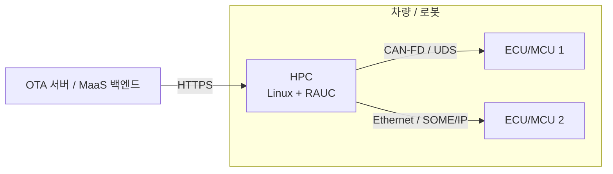
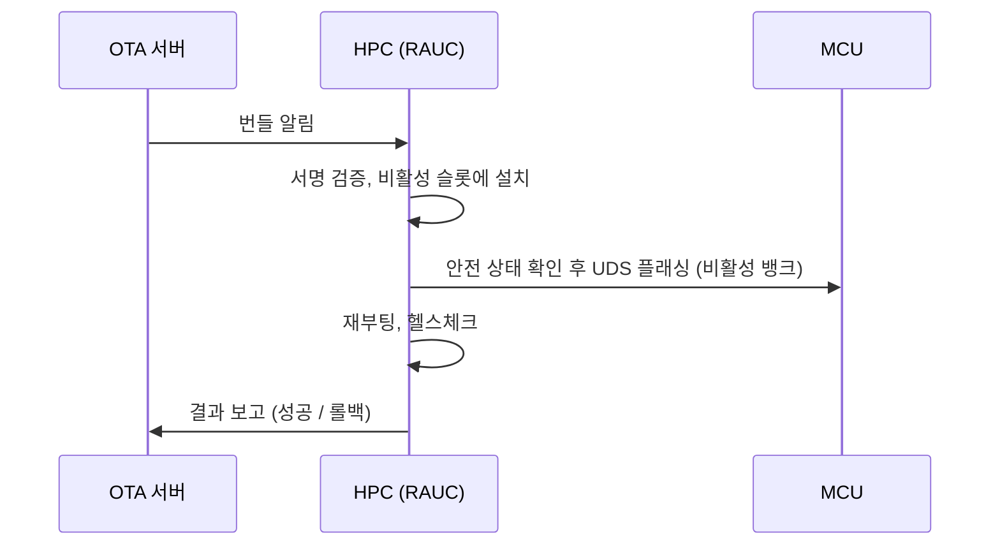

# 아키텍처/설계 문서: <시스템 또는 컴포넌트 이름>

> **언제:** 요구사항이 정리된 뒤, 구현을 시작하기 전에 쓴다. 구조가 바뀌면 갱신한다. **누가:** 모든 역할 (주로 임베디드, 오토모티브).

| 항목 | 값 |
| --- | --- |
| 문서 ID | `ARC-<영역>-<번호>` |
| 버전 / 날짜 | 0.1 / YYYY-MM-DD |
| 관련 요구사항 | REQ-… |
| 관련 ADR | ADR-… |

## 1. 개요 [필수]

<이 구성요소가 하는 일 3줄>

## 2. 시스템 구성도 [필수]

## 3. 구성요소 [필수]

| 구성요소 | 실행 위치 | 책임 | 언어/런타임 | ASIL / 보안 등급 |
| --- | --- | --- | --- | --- |
| OTA 에이전트 | HPC | 번들 다운로드·설치, MCU 플래싱 조정 | C (RAUC) + 훅 스크립트 | QM / 높음 |
| 모터 제어 | MCU1 | 토크 제어 | C (RTOS) | `TODO(HARA 결과)` |
| | | | | |

## 4. 인터페이스 [필수]

세부 내용은 [인터페이스 정의서](interface.md)에 쓰고, 여기에는 목록만 적는다.

| ID | 제공 → 사용 | 프로토콜 | 문서 |
| --- | --- | --- | --- |
| IF-001 | HPC → MCU1 | UDS over CAN-FD | IFD-001 |

## 5. 동작 시나리오 [필수]

주요 흐름 하나 이상을 순서도로 그린다. OTA는 반드시 포함한다.

## 6. 메모리·스토리지 배치 [필수: HPC, MCU]

| 장치 | 영역 | 크기 | 용도 |
| --- | --- | --- | --- |
| HPC eMMC | rootfs.0 / rootfs.1 | `TODO` | A/B 슬롯 |
| HPC eMMC | data | `TODO` | 영속 데이터, 로그 |
| MCU Flash | Bank A / Bank B | `TODO` | 듀얼 뱅크 펌웨어 |

## 7. 안전·보안 고려 [필수]

- 안전 메커니즘 (워치독, 리셋, 안전 상태):
- 신뢰 경계와 공격 표면:
- 관련 HARA/TARA 항목: HZ-…, TS-…

## 8. 미결 사항 [선택]

-
